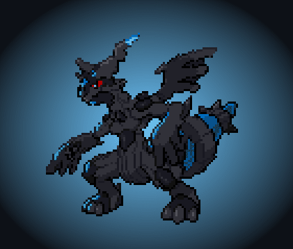

  

  

  
  
  

---

## Sobre mim

Faço o técnico em Desenvolvimento de Sistemas no Senac de Taboão da Serra e termino em abril de 2027. Gosto de pegar um projeto do começo, desenhar a tela no Figma, programar e colocar no ar. Já fiz isso com site, app de celular e API.

Também gosto de segurança. Faço o Google Cybersecurity Certificate e treino no TryHackMe e no PortSwigger Web Security Academy.

Estou atrás de uma vaga de Jovem Aprendiz ou estágio em desenvolvimento.

---

## Projeto principal

### [GuardianNet](https://github.com/Henrique498/GuardianNet_App)
Semifinalista do Empreenda Senac, 19ª edição.

A ideia: como saber se uma criança está falando com alguém perigoso sem ler tudo o que ela escreve? O GuardianNet analisa as mensagens e avisa os responsáveis quando aparece algo como aliciamento, bullying ou ameaça. Cada mensagem recebe um nível: seguro, atenção ou perigo.

A análise junta uma lista de palavras-chave em português com um modelo Naive Bayes (biblioteca River) treinado no corpus PAN12. A criança entra no app com um código de 6 dígitos, sem precisar de e-mail nem senha.

Ainda é um MVP. Login, planos, pareamento e a análise por IA já funcionam. Os contatos e alertas dentro do app ainda usam dados de exemplo, e a leitura automática das mensagens no Android é a próxima etapa.

     

---

## Outros projetos

| Projeto | O que é | Feito com |
| --- | --- | --- |
| [Portfólio](https://github.com/Henrique498/portfolio) ([ver online](https://henrique498-dev.vercel.app/)) | Meu site, sem framework nenhum, com animações de scroll | HTML, CSS, JavaScript |
| [HeliosFit](https://github.com/Henrique498/app_helios2) | App de academia com login, planos e pagamento | React Native, Expo, TypeScript |
| [Desktop](https://github.com/Henrique498/Desktop) | Painel que mostra os sensores de um ESP32 em tempo real | Python, PyQt5, MQTT, Firebase |
| [SitePI](https://github.com/Henrique498/sitePI) ([ver online](https://site-pi-iota.vercel.app)) | Site do projeto integrador do Senac | HTML, CSS, JavaScript |
| [PetConnectta](https://github.com/Henrique498/PetConnectta) | Aplicação web | TypeScript |
| [siteMedico](https://github.com/Henrique498/siteMedico) | Site sobre o Protocolo de Manchester | HTML, CSS |
| [belenuti_veganus](https://github.com/Henrique498/belenuti_veganus) | Protótipo de loja de produtos veganos | C++ |

---

## Linguagens e tecnologias

  

---

  
  

  

